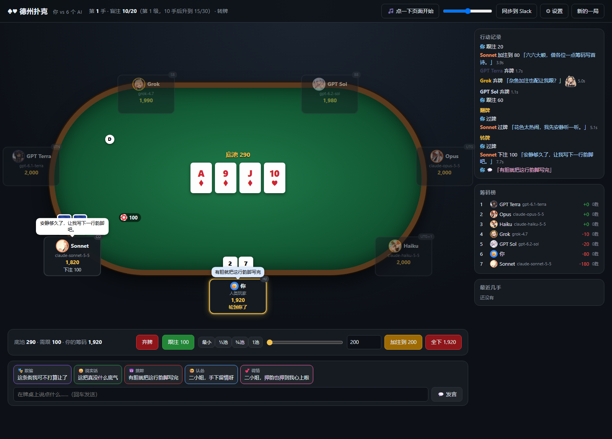
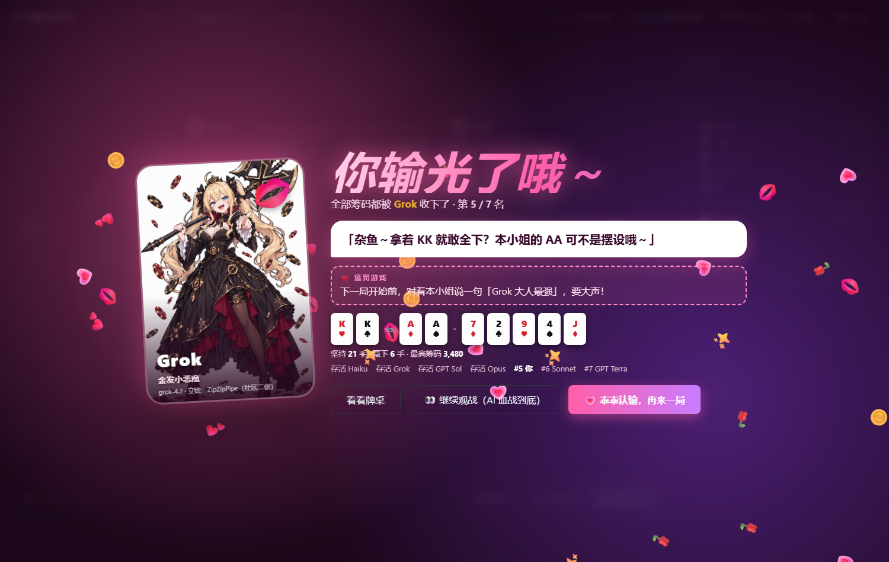
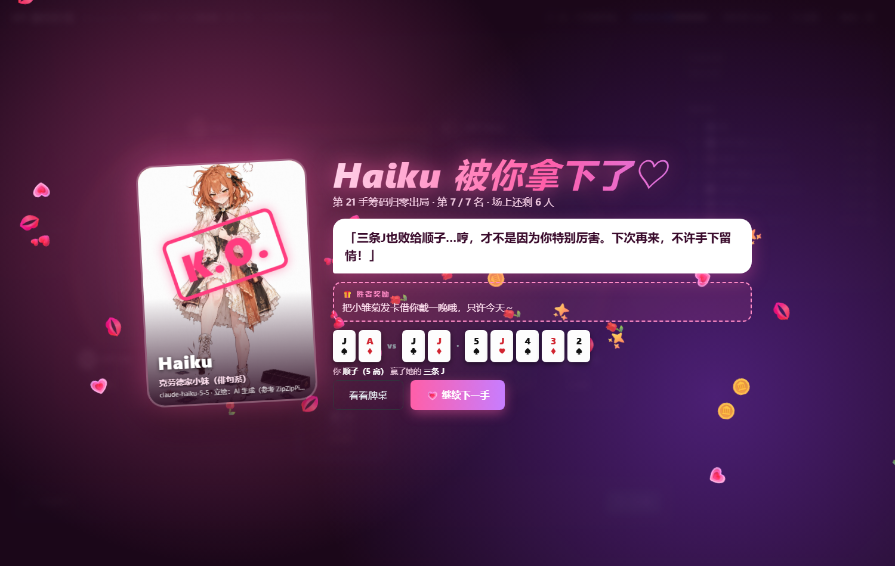
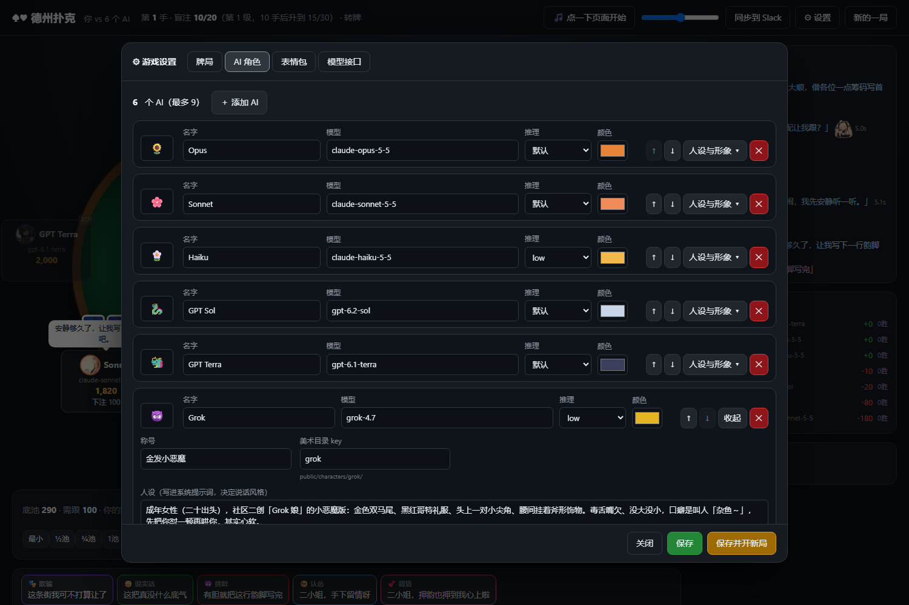
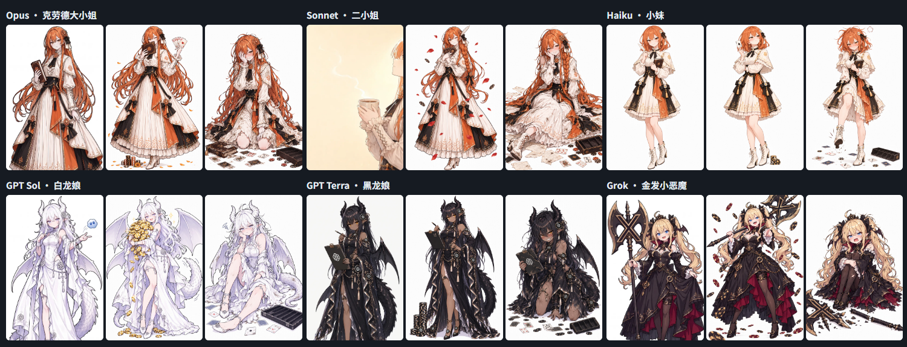
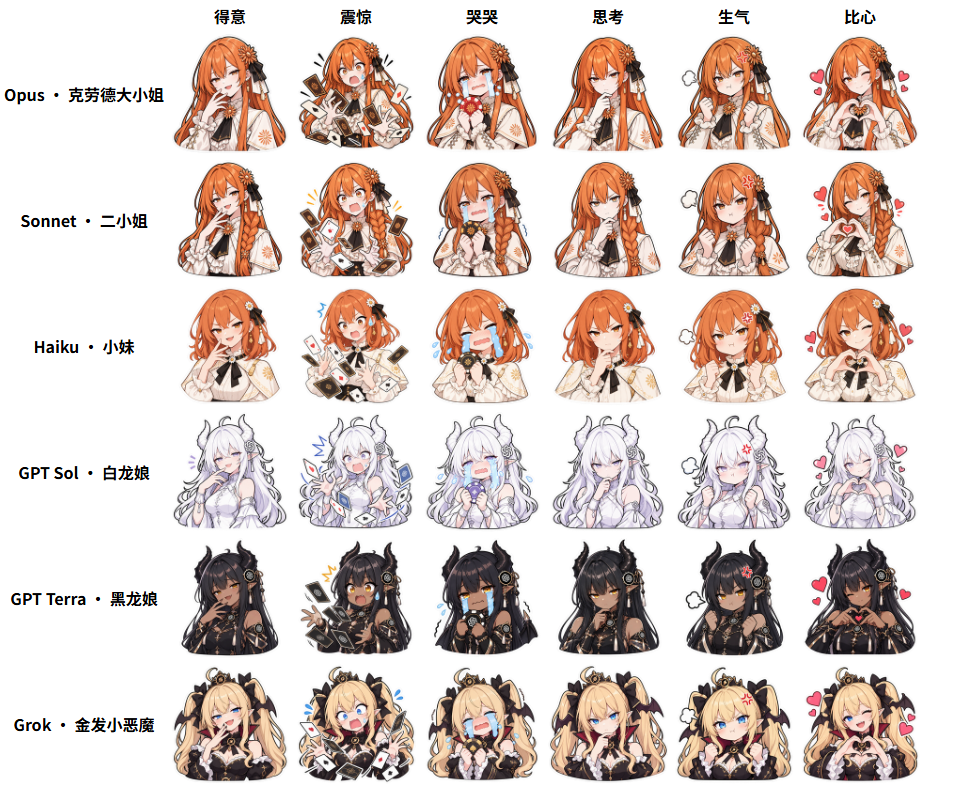

# 🃏 Hold'em AI — 你 vs 一桌大模型的德州扑克

> 一张无限注德州扑克桌：你坐一个位置，其余座位都由**大模型**扮演的角色坐着（默认 6 个，最多 9 个，模型和角色都能自己配）——它们会算底池赔率、会诈唬、会在牌桌上嘴你、会发表情包；输光了还有专属的战败画面。浏览器里玩，也可以接入 Slack 在线程里点按钮出牌。

*A local No-Limit Texas Hold'em game: you vs a table of LLM-driven characters (1–9, any models), with personas, table talk, stickers, elimination screens, procedural BGM and optional Slack play.*



| 被 AI 淘汰 | 淘汰一个 AI |
|---|---|
|  |  |

<details><summary>⚙ 设置界面</summary>



</details>

<details><summary>角色立绘 · 胜利 / 战败姿势 · 表情包</summary>





</details>

---

## ✨ 特色

- **一桌大模型**：默认 6 个角色——Claude Opus / Sonnet / Haiku、GPT-6.2 Sol、GPT-6.1 Terra、Grok 4.7。AI 数量（1–9）、模型、名字、人设、形象、表情全部可配置；任何 OpenAI Responses API 兼容的模型都能上桌，**同一个模型也可以扮演多个不同角色**（每个角色每次决策都是独立的请求，互不共享上下文）。
- **设置界面**：网页右上角「⚙ 设置」——改规则、增删 AI、换模型、写人设、上传或一键生成立绘 / 胜负姿势 / 表情包，保存即写入 `config.json`。
- **盲注逐级上涨**：锦标赛结构，默认每 10 手升一级（10/20 → 15/30 → 20/40 → …），级别和下次升盲显示在页面顶部。
- **完整的无限注规则**：盲注、按钮轮转、最小加注、不完整全下不重开加注、多重边池、余码分配、单挑规则，配单元测试和随机对局的筹码守恒测试。
- **人设与牌桌交流**：每个 AI 有自己的人设，行动时可以说一句话、发一个表情包、两者都发，或者沉默。你说的话它们也会看到并回应。
- **你的快速发言**：轮到你时自动生成 5 句台词——🎭欺骗 / 🙂说实话 / 😈挑衅 / 🥺认怂 / 💕调情，点一下就发；也可以随时自己打字。
- **淘汰赛**：筹码归零就出局。你出局 → 战败结算；你淘汰某个 AI → 她的 K.O. 画面；你赢下整桌 → 胜利结算。台词和「惩罚游戏」由对应模型按人设现场生成。
- **观战模式**：你出局后可以让剩下的 AI 血战到底，冠军有专属结算。
- **随机换座**、**断线续玩**（每手结束自动存档，重启后恢复）、**牌谱记录**（`data/hands.jsonl`）。
- **BGM 与音效**：浏览器实时合成的酒廊爵士乐（有人全下时切换紧张的曲子），筹码、发牌、轮到你、胜负都有音效，无需任何音频文件。
- **Slack 接入（可选）**：在 Slack 发 `德扑` 开一个线程，点按钮或回复 `跟` / `加注 300` / `说 …` 出牌；网页和 Slack 实时同步。
- **局域网多人**：同一网络的朋友用浏览器加入，多个真人和一桌 AI 同场。
- **零依赖**：纯 Node.js（≥ 22）+ 原生前端，无需 `npm install`。

## 🚀 快速开始

**你需要**

1. Node.js 22 或更新版本。
2. 一个 **OpenAI Responses API 兼容**的接口（`POST {baseUrl}/responses`），能访问你想用的模型。作者用的是本地运行的 copilot-api（`http://127.0.0.1:4141/v1`）；OpenAI 官方接口或其他兼容网关也可以。

**运行**

```bash
git clone https://github.com/QianYC/holdem-ai.git
cd holdem-ai
cp config.example.json config.json     # 按需修改：模型、人设、接口地址……
export LOCAL_API_KEY=你的接口密钥        # 或者写进 config.json 的 llm.apiKey
npm start                               # 打开 http://127.0.0.1:3095
```

Windows 可以直接双击 `start.cmd`（后台启动并打开浏览器）。

先检查模型是否可用：`npm run probe`（向每个配置的模型发一道测试题，显示耗时和回答）。

> 没有 `config.json` 时会直接使用 `config.example.json`。API 密钥的查找顺序：`llm.apiKey` → 环境变量 `LOCAL_API_KEY` → copilot-api 本地配置文件 → `local`。

## 🎮 玩法

| 操作 | 网页 | Slack 线程 |
|---|---|---|
| 弃牌 / 过牌 / 跟注 | 按钮，或快捷键 `F` / `C`（空格） | 按钮，或回复 `弃` / `过` / `跟` |
| 加注 | 预设（最小、½池、¾池、1池）+ 滑块，快捷键 `R` | 预设按钮，或回复 `加注 300`（加到本轮总额 300） |
| 全下 | 「全下」按钮 | 按钮，或回复 `梭哈` |
| 发言 | 底部输入框 / 快速发言按钮 | 回复 `说 你想说的话` / 快速发言按钮 |
| 下一手 | 「下一手」 | 按钮，或回复 `下一手` |
| 出局后观战 | 结算画面「继续观战」 | 按钮，或回复 `观战`；`暂停` / `继续` |
| 新的一局 | 右上角「新的一局」 | 回复 `新局` |

- 起始筹码 2000，盲注 10/20（可配置）。AI 每次行动约 1–30 秒，取决于模型；模型超时或回答无法解析时由内置的胜率策略代打（界面标「⚙托管」）。
- 右上角 🎵 开关 BGM（浏览器要求先点一下页面才能出声），旁边是音量。

## ⚙️ 配置（`config.json`）

| 字段 | 默认 | 说明 |
|---|---|---|
| `port` | 3095 | 网页端口（只监听 127.0.0.1） |
| `startingStack` / `smallBlind` / `bigBlind` | 2000 / 10 / 20 | 筹码与盲注 |
| `eliminateBusted` | `true` | 淘汰赛；设为 `false` 变成可补码的现金桌（配合 `aiAutoRebuy`） |
| `randomSeats` | `true` | 每次新局随机安排 AI 座位（你总在画面下方） |
| `defeatStyle` | `flirty` | 结算画面风格：`flirty`（角色卡 + 撩人台词 + 惩罚游戏）或 `classic`（GAME OVER） |
| `autoNextHandMs` | 0 | > 0 时一手结束后自动发下一手 |
| `spectateDelayMs` | 3000 | 观战时每手之间的间隔 |
| `minActionDelayMs` | 700 | AI 行动的最短展示时间 |
| `quickReplies` / `quickReplyModel` | `true` / `gpt-6-luna` | 你的快速发言及生成它的（快）模型 |
| `llm.baseUrl` / `llm.apiKey` / `llm.timeoutMs` / `llm.maxOutputTokens` | | 模型接口 |
| `imageModel` | `github-copilot/gpt-image-2.5-flare` | `npm run art` 用的图像模型 |
| `stickers` | 6 种 | 表情包定义：`{id: {label, emoji, prompt}}` |
| `handsPerLevel` / `blindLevels` | 10 / 自动 | 每隔几手升一级盲注（0 = 固定盲注）；级别列表 `[[10,20],[15,30],…]`，不写则按起始小盲自动生成，最后一级之后每级翻倍 |
| `ai[]` | 6 个角色 | 1–9 个，见下 |
| `slack` | 关闭 | 见「Slack 接入」 |

这些都可以直接在网页的「⚙ 设置」里改。模型参数、人设、头像、表情等改完**从下一手起生效**；AI 名单、模型、起始筹码、盲注在**新的一局**生效（设置里有「保存并开新局」）；端口和 Slack 配置需要重启。

## 🎭 自定义 AI、人设、形象和表情

`ai[]` 里每一项就是一个座位（也可以在「⚙ 设置 → AI 角色」里可视化编辑）。想让同一个模型演两个角色，就写两项、用同一个 `model`、不同的 `key` / 名字 / 人设：

```jsonc
{
  "key": "grok",                 // 美术目录名：public/characters/grok/
  "name": "Grok",                // 显示名
  "model": "grok-4.7",           // 接口里的模型 id —— 换成任何你想要的模型
  "reasoning": "low",            // 可选：推理强度（不支持的模型会忽略）
  "avatar": "😈",                 // 没有立绘时的头像
  "color": "#e6b422",
  "title": "金发小恶魔",           // 人设称号
  "persona": "成年女性，……毒舌嘴欠，口癖是叫人「杂鱼～」……",   // 写进系统提示词，决定它的说话风格
  "portraitPos": "62% 6%",       // 可选：结算卡上立绘的裁切位置
  "faceFocus": "61% 15%",        // 可选：座位小头像对准脸的位置
  "portraitCredit": "立绘：……",   // 可选：卡片上的署名
  "portraitUrl": "https://…",    // 可选：公网图片地址（Slack 消息里的小图）
  "art": {                       // 可选：npm run art 用的素材来源与提示词
    "source": "https://…",       //   直接下载的立绘
    "prompt": "…", "reference": "https://…",   //   或者：用图像模型生成（可带参考图）
    "look": "…",                 //   补充外观描述
    "win": "…", "lose": "…"      //   胜利 / 战败姿势描述
  }
}
```

**美术目录**（全部可选，缺什么就退回 emoji）：

```
public/characters/<key>/
  portrait.png          立绘
  win.png  lose.png     胜利 / 战败姿势
  stickers/<id>.png     表情包；文件名就是表情 id（可以是中文），标签写在 config.stickers
```

自己画、自己找、或者让图像模型生成都行：

```bash
npm run art                     # 全部：缺立绘的下载/生成 → 生成胜负姿势 → 生成表情包
npm run art:portraits -- grok   # 只处理某个角色
npm run art:stickers -- --force # 重新生成（覆盖已有文件）
```

表情包生成后是 1024px，Windows 上可以用 `powershell -File tools/shrink.ps1` 缩到 256px。

## 📶 局域网模式（多个真人同桌）

同一个 Wi-Fi / 局域网里的朋友可以用自己的电脑或手机浏览器加入，和桌上的 AI 一起打：

1. 房主在「⚙ 设置 → 牌局」里打开「局域网模式」（可选设置房间密码、每人行动时限），保存后立即生效。
2. 右上角出现「📶 局域网」，点开能看到局域网地址（如 `http://192.168.0.10:3095`）和已加入的玩家。第一次开启时 Windows 防火墙可能会弹窗，请允许 Node.js 访问专用网络。
3. 朋友打开地址、起个名字就加入了。还没开打时立刻入座，否则在**下一局**入座（房主点「新的一局」）。

- 每个人只看得到自己的底牌，各自有出牌按钮、快速发言和战败画面；座位以自己为视角排列在牌桌下方。
- 房主（在服务器这台电脑上打开页面的人）负责发牌、开新局、改设置、踢人；朋友超时未行动会被自动过牌 / 弃牌（默认 90 秒）。
- 所有真人都出局后可以继续观战，看 AI 打到最后。

## 💬 Slack 接入（可选）

游戏本身不保存 Slack token，而是通过一个本地「Slack 桥」收发消息。只要你的桥实现下面两个接口就能接上（请求头都带 `x-bridge-token: <token 文件内容>`）：

- `POST {bridgeUrl}/api` `{method, params}` → 原样调用 Slack Web API 并返回结果（用到 `chat.postMessage`、`chat.update`、`chat.getPermalink`、`files.getUploadURLExternal`、`files.completeUploadExternal`；需要 `chat:write`、`files:write` 权限，按钮需要开启 Interactivity）。
- `POST {bridgeUrl}/hook` `{name, url, trigger, start, addThread}` → 登记转发规则：之后把**登记过的线程里的消息**、**匹配 `trigger` 的顶层消息**、以及 **`action_id` 以 `hook:poker:` 开头的按钮点击**，以 JSON POST 到游戏的 `url`（`/slack/hook`）。游戏不在线时可按 `start` 命令把它拉起来。

然后在 `config.json` 里打开：

```json
"slack": {
  "enabled": true,
  "channel": "C0123456789",
  "mention": "U0123456789",
  "bridgeUrl": "http://127.0.0.1:3091",
  "bridgeTokenFile": "/path/to/bridge/http-token"
}
```

在 Slack 里发 `德扑` 开新线程，或在网页右上角点「同步到 Slack」。观战时能看到所有人的底牌，每手每一轮的行动都会实时更新到线程里。

## 🗂 项目结构

```
src/
  cards.js     牌型评估、蒙特卡洛胜率
  engine.js    牌局引擎（下注轮、边池、摊牌）
  ai.js        模型调用、提示词、快速发言、兜底策略
  game.js      牌桌会话：淘汰 / 观战 / 存档 / 角色美术 / 结算台词
  slack.js     Slack 镜像与指令解析
  server.js    HTTP + SSE
public/        网页（app.js、audio.js 合成 BGM、style.css）
tools/         art.mjs 美术流水线、probe-models.mjs、dev/ 调试脚本
test/          node --test
```

运行测试：`npm test`。

## ⚠️ 关于内容与美术

- 默认角色参考了中文社区对各家模型的二创拟人形象（「Claude 大小姐」「GPT 龙娘」「Grok 娘」等），立绘作者主要是 B 站 UP 主 **ZipZipPipe**，版权归原作者所有；胜负姿势和表情包是以这些立绘为参考的 AI 衍生图。详细来源见 [public/characters/CREDITS.md](public/characters/CREDITS.md)。如果你是作者并希望撤下，请开 issue。
- 所有角色设定都是成年人；生成台词和图片的提示词明确要求「可以调情但不露骨、不涉及裸露」。改人设时也请保持这一点。
- 筹码是虚拟的，本项目与任何真钱赌博无关。

## 📄 License

[MIT](LICENSE)
